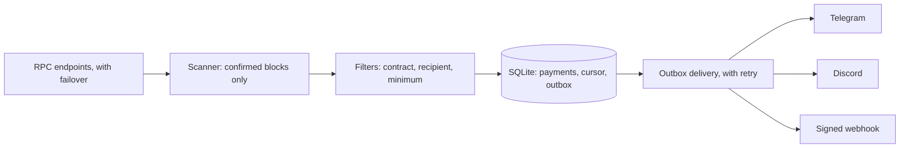

# Stablecoin payment watcher

Know when a USDT or USDC payment has really arrived: check a transaction hash in one command, or watch your wallet and get an alert on Telegram, Discord or your own webhook once the payment is confirmed.

[](https://github.com/alex-pubgit/stablecoin-payment-watcher/actions/workflows/ci.yml)


```text
$ paywatch check-tx --chain bsc --min-amount 500 \
    --tx 0xdc1fe171f6a09571188607de09f71a401c50783d7bceee99fd72cf6d275ddebc \
    --to 0x4620f5c127a6055fbebb1f71327d60ff079c9060
PASS
  - transaction succeeded
  - 969.250360260820715703 USDT from the genuine contract to 0x4620...9060
  - 1303 confirmations (15 required)
  - https://bscscan.com/tx/0xdc1fe171f6a09571188607de09f71a401c50783d7bceee99fd72cf6d275ddebc

$ paywatch check-tx --chain bsc --min-amount 5000 --tx 0xdc1f...debc --to 0x4620...9060
FAIL
  - Only 969.250360260820715703 USDT arrived. At least 5,000.00 was expected.
```

That is a real transaction on BNB Smart Chain, so you can run the first command yourself. The confirmation count will be higher by then.

**Read-only by design.** This tool only reads public blockchain data. It never asks for, stores or uses a private key or seed phrase, and it cannot send or sign anything.

This is a demo and reference implementation.

## What you get

- **`check-tx`**: a claimed payment passes only if the transaction succeeded, moved the genuine token contract, to your address, for at least the agreed amount, with enough confirmations. Otherwise it says exactly which of those failed.
- **`watch`**: alerts for confirmed incoming payments to one or more wallets, on the console, Telegram, a Discord webhook, or your own HMAC-signed webhook.
- **Scam filters**: look-alike tokens, zero-value "address poisoning" transfers and dust never produce an alert.
- **Nothing lost, nothing doubled**: state lives in SQLite, so a restart resumes where it stopped and each payment is alerted once.
- **BNB Smart Chain, Ethereum and Polygon** out of the box, with amounts handled as exact integers on every chain.

## Try it in 2 minutes

No account or API key. Needs Python 3.11 or newer and an internet connection.

```bash
git clone https://github.com/alex-pubgit/stablecoin-payment-watcher.git
cd stablecoin-payment-watcher
python -m venv .venv
source .venv/bin/activate        # Windows: .venv\Scripts\activate
pip install -e .

paywatch verify-presets          # reads every preset token back from its chain
paywatch check-tx --chain bsc --min-amount 500 \
  --tx 0xdc1fe171f6a09571188607de09f71a401c50783d7bceee99fd72cf6d275ddebc \
  --to 0x4620f5c127a6055fbebb1f71327d60ff079c9060
```

```text
ok        bsc       USDT  0x55d398326f99059ff775485246999027b3197955  on-chain: symbol=USDT decimals=18
ok        bsc       USDC  0x8ac76a51cc950d9822d68b83fe1ad97b32cd580d  on-chain: symbol=USDC decimals=18
ok        ethereum  USDT  0xdac17f958d2ee523a2206206994597c13d831ec7  on-chain: symbol=USDT decimals=6
ok        ethereum  USDC  0xa0b86991c6218b36c1d19d4a2e9eb0ce3606eb48  on-chain: symbol=USDC decimals=6
ok        polygon   USDC  0x3c499c542cef5e3811e1192ce70d8cc03d5c3359  on-chain: symbol=USDC decimals=6
```

`check-tx` exits with 0 for PASS, 1 for FAIL and 2 when it could not check, so it fits into a script.

## Watch your wallet

```bash
cp examples/paywatch.example.toml paywatch.toml    # set your address and tokens
paywatch watch --config paywatch.toml
```

```text
Payment confirmed: 4.945652173913043471 USDT on BNB Smart Chain
To 0x8bc0...b689 from 0x1ee9...7de8
https://bscscan.com/tx/0x122e44c1915f00584c6aeada6dec7afc8d19c1dfd3e4bec5c75d132aade97d60
Payment confirmed: 10.7694 USDT on BNB Smart Chain
To 0x8bc0...b689 from 0x24fd...215a
https://bscscan.com/tx/0xa74bc27224c2ceacace7fcf55cf88aeb4155fb272ea3debc393fdd3d006f0cfe
```

That excerpt is from a live test against a busy public address. `--once` scans and exits, for cron. `--from-block N` reads history from block N.

Alerts are switched on in the `[notify]` table, and their secrets come from the environment:

| Notifier | Config | Environment variable |
|---|---|---|
| Console | `console = true` | |
| Telegram | `telegram_chat_id = "..."` | `PAYWATCH_TELEGRAM_TOKEN` |
| Discord | `discord = true` | `PAYWATCH_DISCORD_WEBHOOK` |
| Your webhook | `webhook_url = "https://..."` | `PAYWATCH_WEBHOOK_SECRET` |

The webhook body is JSON with an `X-Paywatch-Signature: sha256=...` header. Verify it against the raw body before trusting it:

```python
from paywatch.notify import verify_signature

if not verify_signature(secret, request_body_bytes, request.headers["X-Paywatch-Signature"]):
    return 401
```

`X-Paywatch-Id` identifies the payment. Store it and ignore an id you have already processed.

## The three scams this is built around

- **Look-alike tokens.** Anyone can deploy a token whose symbol reads "USDT". Wallets and explorers show that symbol. Only the contract address tells the real one apart, so this tool matches the contract address and nothing else.
- **Address poisoning.** A scammer sends you a zero-value or tiny transfer from an address that resembles one you use, hoping you later copy it from your history. Zero-value transfers and anything under your `min_amount` are ignored.
- **Fake proof of payment.** A screenshot can be edited, and a hash can belong to a failed transaction, another token, another recipient or a smaller amount. `check-tx` reads the chain instead of the picture.

## Token presets

| Chain | Token | Contract | Decimals | Checked on 2026-11-18 |
|---|---|---|---|---|
| BNB Smart Chain | USDT | `0x55d398326f99059fF775485246999027B3197955` | 18 | On-chain |
| BNB Smart Chain | USDC | `0x8AC76a51cc950d9822D68b83fE1Ad97B32Cd580d` | 18 | On-chain |
| Ethereum | USDT | `0xdAC17F958D2ee523a2206206994597C13D831ec7` | 6 | On-chain and Tether's supported-protocols page |
| Ethereum | USDC | `0xA0b86991c6218b36c1d19D4a2e9Eb0cE3606eB48` | 6 | On-chain and Circle's contract-address page |
| Polygon | USDC | `0x3c499c542cEF5E3811e1192ce70d8cC03d5c3359` | 6 | On-chain and Circle's contract-address page |

"On-chain" means `symbol()` and `decimals()` were read from the contract and match. That alone does not prove a token is genuine, because a fake returns the same symbol. The two BNB Smart Chain tokens are Binance-Peg tokens, and I found no issuer page listing their addresses to compare with, so compare them with the explorer's verified token pages yourself before relying on them.

There is deliberately **no USDT preset for Polygon**. The contract commonly used for it now reports its symbol as `USDT0`, and Tether's own list gives no Polygon address. Add it under `[[token]]` if you accept it.

The same symbol does not mean the same decimals: USDT has 18 on BNB Smart Chain and 6 on Ethereum. Amounts are parsed and compared as integers per token.

## How it works



What `watch` promises, precisely:

- It only reads blocks that are at least `confirmations` deep, so an alert means the transfer had that many confirmations when it was seen.
- Each payment is recorded once, keyed by chain, transaction hash and log index. A scanned range, its payments and the queued alerts are written in a single database transaction.
- Alerts are delivered at least once per notifier. If the process dies between sending an alert and recording that it was sent, that alert repeats after restart.
- A failing notifier is retried with a doubling delay, capped at one hour, and never holds up the others.
- A reorganization deeper than `confirmations` is not detected, and an alert cannot be taken back. The presets (15 blocks on BNB Smart Chain, 12 on Ethereum, 30 on Polygon) are defaults, not finality guarantees.

## Quality

```bash
pip install -e ".[dev]"
pytest                      # 85 tests, offline
ruff check . && ruff format --check .
```

| Part | Status |
|---|---|
| Decoding, checksums, amounts, scanning, restart safety, retries, `check-tx` verdicts, config errors | Tested offline on Python 3.11 and 3.13 (locally on Windows; CI runs them on Ubuntu). Log decoding is tested against a real node response |
| `verify-presets` | Run live on all three chains on 2026-11-18 |
| `check-tx` | Run live on BNB Smart Chain: one pass, and failures for a wrong recipient, a short amount, a wrong token and an unknown hash |
| `watch` | Run live against busy public addresses on all three chains. BNB Smart Chain: 1,017 transfers across three runs, each alerted exactly once. Ethereum and Polygon: 53 and 56 transfers, none repeated on a second run |
| Signed webhook | Run live over HTTP against a local receiver that checks every signature: 413 alerts delivered, 413 valid signatures. With a wrong secret the receiver answered 401 and the alerts stayed queued for retry |
| Telegram and Discord notifiers | Tested against mocked HTTP only. Not sent to a real chat or channel |
| Docker image | Built and smoke-tested by CI. Not run locally |

## Design decisions

- **Confirmed blocks only.** Scanning stops `confirmations` below the head instead of reporting "pending" and correcting later. An alert you cannot take back should not be sent early.
- **An outbox, not a send-then-save.** Payments and their pending alerts are committed together, and delivery happens from the database. That is what makes a crash at any point safe.
- **Two kinds of RPC failure.** An unreachable endpoint triggers failover and backoff. A JSON-RPC refusal of `eth_getLogs` means the block range is too large for that node, so the range is halved. Public nodes differ a lot here: during testing one refused more than 50 blocks, and another returned at most 20,000 results.
- **Filter twice.** The node filters by contract and recipient, and the code checks both again. A faulty or hostile endpoint cannot inject a payment.
- **Integers for money.** Amounts are never floats. `60.5` with 6 decimals is the integer 60500000, and the alert shows the exact on-chain value.
- **A checksum failure stops the program.** A mixed-case address that fails EIP-55 has a mistyped character, and a payments tool should refuse to guess.
- **Secrets never in the config file**, and never in logs: error messages name the destination, not the URL, because a Telegram API URL contains the bot token.

## Limitations

- The built-in RPC endpoints are public and rate-limited. Use your own provider's URLs (`[rpc]` in the config) for anything that matters.
- Token payments only. Native BNB, ETH or POL transfers are not watched.
- The amount is the value in the `Transfer` event. A token that charges a transfer fee would deliver less than that. USDT and USDC do not charge one today.
- One wallet address can receive from many payers, and this tool does not tell them apart or match payments to invoices.
- One process, one SQLite file. Run a single instance per database.

## Project layout

```text
src/paywatch/
  evm.py          addresses, checksums, Transfer logs, exact amounts
  chains.py       chain and token presets
  rpc.py          JSON-RPC with failover, adaptive log scanning
  watcher.py      confirmed-only scanning and outbox delivery
  store.py        SQLite: cursor, payments, outbox
  checktx.py      verdict for a single transaction
  notify.py       console, Telegram, Discord, signed webhook
  config.py, cli.py
examples/         config file template
```

## Need this adapted to your business?

I build payment checks, alerts and integrations like this for real projects. See [github.com/alex-pubgit](https://github.com/alex-pubgit).

## License

MIT. See [LICENSE](LICENSE).
